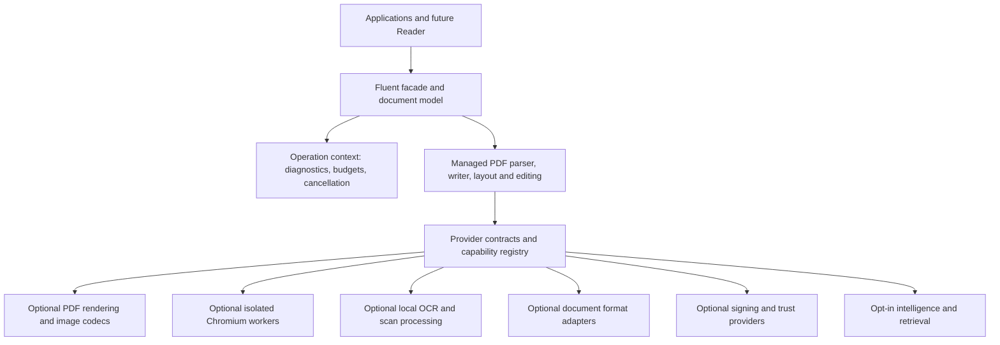

# Architecture

## Boundaries

The diagram is a target architecture. FP-001 implements the in-memory page model, immutable options and provider-backed I/O contracts described in [api-contract.md](api-contract.md). FP-003 adds [low-level syntax inspection](pdf-syntax.md); FP-005 adds the original managed [page reader and transactional writer](pdf-writing.md). FP-007 adds [typed content and version negotiation](content-operators.md). FP-008 adds an optional original [managed font provider](fonts.md); the core retains provider-neutral contracts and authored Type 3 resources. FP-009 adds original managed Unicode analysis and an optional isolated text shaper; [text contracts](text-shaping.md) retain logical Unicode and exact glyph geometry. FP-010 adds [managed vector/resource composition](vector-graphics.md), preserving color profiles, mesh/gradient data and vector transparency groups/masks. FP-011 through FP-015 add shared-context canvas, flow, tables, composition and bounded final page templates with deferred navigation. Rendering and later engines remain in progress.

## Managed core

The core owns PDF syntax/object identity, stream semantics, editing transactions, layout, strictness, diagnostics and public contracts. Native/provider types never appear in its public API. Cross-platform code does not depend on desktop sessions, GDI+ or installed office applications.

Use a typed object model with stable source/page/object provenance and explicit dirty state. Preserve safe unknown keys and opaque streams; changing a document must not silently discard unrecognized extensions. Low-level operators and high-level layout share resource ownership and version negotiation.

A document is an explicitly disposable editing session. Options are immutable snapshots. FP-001 validates individual geometry/collection edits before applying them and supplies detached snapshots to writers. General edit transactions and revision/signature behavior belong to later requirements. Incremental signing paths will preserve byte ranges; full rewrite paths will record signature/revision effects.

## Operation context

Each operation receives cancellation, deadlines, input/expanded/output budgets, object/depth/pixel limits, culture, deterministic font/model/engine selection, strictness, network policy and a diagnostic sink. A provider cannot weaken this context. Managed checks precede allocation; native/browser work is supervised for time, memory and process failures.

Diagnostic records use stable codes, severity, operation, page/object/region provenance, remediation and a loss category. Permissive output carries a complete loss report; strict output fails when requested behavior cannot be honored.

FP-002 implements immutable policy/limits, synchronized operation contexts, page/object diagnostic provenance, bounded input/output/decoder leases, overflow-safe counters and pixel dimensions, scoped depth/workers, cooperative deadlines and detached reports. Read/write providers must accept this context. Fatal policy failures are latched until the operation ends. See [operation-policies.md](operation-policies.md). Region-level provenance, network/resource-loading policy and supervised native workers are owned by the later feature requirements; no such engine is bundled or qualified here. FP-085 adds [offline deployment checks and isolated workers](native-deployment.md), implemented outside the core in the optional non-packable worker adapter and original native host. It checks pinned assets, probes ABI/version/dependencies and supervises platform-sandboxed execution. Native source validation passed; production qualification remains incomplete.

## Optional provider packages

Planned names are subject to prefix availability checks:

| Candidate package | Responsibility |
| --- | --- |
| Fluent.Pdf | Managed core, public contracts, fluent task APIs |
| Fluent.Pdf.Rendering | PDF raster/rendering and viewing primitives |
| Fluent.Pdf.Html | Chromium HTML/URL workers and print layout |
| Fluent.Pdf.Ocr | Local OCR, models/provisioning contracts, searchable PDF |
| Fluent.Pdf.Fonts | Optional redistributable font assets and deterministic resolution |
| Fluent.Pdf.Documents | Optional wordnet/document conversion adapter |
| Fluent.Pdf.Formats | Original bounded interchange/data profiles and explicit optional converter contracts; Core-only managed dependency |
| Fluent.Pdf.Signing | External/HSM signing integrations |
| Fluent.Pdf.Intelligence | Explicit model/retrieval integrations |
| Fluent.Pdf.Native.* | Qualified RID-specific assets or provisioning manifests |

Packages share a release version when shipped together. Do not add empty provider packages. Provider selection must record engine/model version, SHA-256, ABI, platform applicability and capability set. Packaged native dependencies require licensing and servicing review. Runtime auto-download is off by default.

## Engine selection

Chromium is the intended optional web-layout engine. PDFium, PDF rendering through PdfPig/Skia, Tesseract and other engines are candidates, not settled dependencies merely because they appear in research. Qualify candidates on all required platforms for fidelity, memory, cancellation, distribution and security before adopting them. A renderer is not a general PDF editing core.

Legacy interpreter formats and untrusted native decoding use worker isolation. Define authenticated local/remote worker transport, crash recovery and per-job ownership. A container or remote worker is an explicit deployment mode; the SDK must not silently contact a hosted service.

## wordnet integration

The OCR patterns and exact upstream revision are assessed in [ocr-reuse.md](ocr-reuse.md). Extract/adapt only the reusable layer with attribution; its current English model and Windows/Linux release evidence do not establish multilingual/macOS support here.

A separate document adapter may depend on wordnet. The core must not depend on wordnet.Ocr, and wordnet must not gain a dependency back to this adapter. Prefer shared provider-neutral abstractions or an independently factored component if reuse would form a cycle.

## Security and standards

Do not execute PDF JavaScript, launch actions, external resources or embedded media by opening a document. Script evaluation and browser rendering are explicit operations with separate permissions. Redaction uses content removal and full rewrite, including revision/attachment policy; a visual rectangle is insufficient.

Conformance is established by independent validators and semantic review where required. PDF/A, accessibility, signatures and invoice compliance each have dedicated evidence. An emitted metadata flag is not proof.

## Reader boundary

apps/PdfReader is a separate non-packable project. It will consume public SDK contracts for rendering, navigation, search and interaction after a later specification. No GUI framework, visual clone, Reader runtime or desktop distribution is selected in this baseline.

The page canvas emits private vector Form XObjects under the managed core. Geometry captures all five standard boxes, viewing rotation and UserUnit. Completed canvases are immutable; synchronous builders own one operation context and thread. Application stages page resource/layer changes before committing. Source overlays retain the original encoded content streams behind an isolated graphics state.

Flow layout preserves paragraph bidi resolution and reshapes each wrapped line before painting rich text. Constraint planning and immutable page canvas construction share one bounded context. The planner stages complete results; save remains a separate managed document boundary.

Tables share the flow context for grid measurement, nested content, safe intervals and canvas output. Fragment painting copies individual placements with their captured clips, preserving one body text instance per fragment and intentional repeated headers. Nested continuation headers reserve ordered common bands.

Composition paints logical block order, including physical right-to-left columns. Basic column tagging wraps page-level content segments with MCIDs and builds ordered standard Div elements plus a parent number tree. This is separate from complete accessibility/conformance and explicit source-structure remapping. Footnotes reserve body space before committing their references; immutable definitions remain job-local in the planner.

Image assets retain immutable encoded byte stores and display metadata. Inspection captures source-owned resource scopes; occurrence editing clones the selected Form path in a transaction. Image decoding stays behind explicit provider interfaces; the managed core performs no color conversion or PDF rendering.

Annotation operations preserve source graphs through staged transactions and remap exact indirect identities on import. Normal appearances remain independent Forms with private resources. The owned XFDF graph extension retains encoded bytes and relationships within explicit XML/work/ownership ceilings. No imported action or media is evaluated.

Navigation binds local destinations to native page identities and validates reachable targets before document writes. Action inventory walks active object definitions and physical attachment edges without executing content; explicit sanitization stages a full graph overlay.

Presentation edits share the navigation graph boundary and retain indirect page identities. Outline link/count construction, number-tree inspection and preference validation remain managed and passive; unknown settings stay observable with diagnostics.

Metadata edits use the shared managed graph transaction. XML is preflighted and charged before bounded tree construction, with external resolution and DTDs disabled. Synchronization uses caller-selected authority and dates; removal rewrites the graph and requires an embedded-file decision. No system clock or random identity is introduced.

Embedded-file operations keep payload bytes behind bounded stream/filter leases. Extraction validates into private storage before output; same-directory file commits default to no overwrite. Inventory is passive, while collection and associated-file authoring use explicit PDF structures. Removal rewrites the full graph and drops prior revisions.

Optional-content decisions are operation-local and passive. Configuration evaluation binds exact OCG identities and explicit usage events. Flattening stages private resource/content rewrites, preserves graphics-state side effects and rejects unresolved state/semantic dependencies before commit.

Text extraction interprets page/Form text state in the shared context, caching source mappings/metrics per operation. It preserves source code order and declared ActualText independently of bounded geometric grouping. Coordinate records retain native user space and the existing displayed CropBox/rotation/UserUnit transform.

AcroForm capture resolves inherited field attributes under the graph operation context and keeps logical fields separate from exact terminal/widget identities. Edits preserve source object and structure links; authored private appearances and explicit default editing fonts have separate ownership. Scripts/XFA are never run during capture or editing.

Field-data parsing remains independent from document mutation. Filling/appearance generation shares the graph context; copy operations map exact ownership/resources and flattening removes both field-tree and page-widget relationships before validating surviving references. Incremental graph output preserves original bytes without asserting signature validity.

FP-031 keeps password/file-security algorithms in managed core and CMS behind `IPdfCmsEnvelopeProvider`. Optional `Fluent.Pdf.Cryptography` composes pinned ASN.1 and platform RSA/AES, without certificate-store discovery or private-key export. Explicit plaintext/security rewrites retain shared budgets and signature safeguards; see [security](security.md).

Archival generation/conversion uses the managed graph/writer and an explicit independent validator boundary. Core preflight is not a conformance oracle. Optional Fluent.Pdf.Compliance checks exact reports from a caller-supplied offline host; no browser/native/Java runtime is linked into core. Staged archival downgrades cannot reach caller output without complete matching independent validation.

Structural recovery has a separate scanner, explicit identity/stream authority, immutable original bytes and ledger. It does not catch ordinary parse errors or guess markers inside stream payloads. Reconstructed output passes the normal strict reader before final copying; this is structural validation rather than PDF standards or content-fidelity qualification.

PDF compatibility inspection retains raw immutable graph values and explicit version provenance; text encoding remains separate from binary/font-code strings. Typed text placement carries a version floor while low-level callers declare it explicitly.

HTML source capture stays managed and immutable. Optional Fluent.Pdf.Html owns original version-bound DevTools commands, private context/target creation, resource interception and streamed printing over an explicit supervised-host connection. Browser PDF imports through the normal reader under the same operation context. The qualified OS process/network/memory boundary remains a separate mandatory host obligation; the development fixture host is not its qualification.

FP-045 places resource/DNS/HTTP/authentication policy in the optional HTML adapter. Browser network access remains denied by the required host; the managed loader authorizes every origin and resolved numeric endpoint, maintains private origin/job cookies, and captures decoded bytes under the same rendering context. Core contracts import no HTTP/browser/platform dependency. Explicit protected-file/data snapshots do not grant browser filesystem access. See [resource boundaries](html-resources.md).

FP-046 phase deadlines stay in the managed operation boundary. A provider can tighten time temporarily without changing the context/token or extending the original deadline; disposing an expired phase still latches failure. Optional browser readiness combines DOM/asset snapshots and bounded network inventories, while every job retains private process/context ownership. The ordinary managed import/output boundary remains unchanged.

FP-047 keeps print policy in the managed core and browser commands/template normalization in the optional HTML adapter. Requested tagging is checked after ordinary managed import, under the same context, before exposing a document. The page/structure/parent-tree association profile is separate from full PDF/UA semantics and human accessibility qualification.

FP-018 composes captured sources through the existing canvas/resource writer, then stages private page invocation/scope streams in the managed graph transaction. Visible removal validates exact private ownership and preserves shared resources/unrelated content. Internal HTML rendering is reusable under one context so stamp capture never resets its resource or time budget.

FP-028 separates immutable resource identities, effective bindings and operator occurrences. Same-context page/Form traversal retains per-segment transforms and source provenance; optional explicit font inspection never discovers host fonts. See [resource extraction](resource-extraction.md).

FP-026 shares one capture/extraction/matching/shaping/font/write context. Replacement edits exact source strings with TJ advance compensation and isolated explicit-font foreground text; unsupported owner/reflow profiles reject. See [text search](text-search.md).

FP-027 uses one graph/text/resource context for explicit geometric inference. Immutable page cells keep source provenance; continuation groups retain original headers, and interchange has separate bounded/atomic export contexts. See [table extraction](table-extraction.md).

FP-099 shares binding/layout/template/model/write helpers under one root generation context. Private model assembly carries the context into page/resource mutations; immutable observer views and phase/thread/cycle guards protect staged work. See [data generation](data-generation.md).

FP-050 uses original managed bounded parsers through generation, immutable explicit font/style/resource capture and private same-context post-layout link assembly. Unknown source content is diagnostic; no dynamic code, default resolver or resource discovery is introduced. See [input conversion](input-conversion.md).

FP-053 keeps core independent of Word dependencies. An optional pinned adapter uses bounded original RTF/WordprocessingML, passive package checks and shared-context extraction/rendering/IO, with explicit reconstruction provenance and loss policy. See [Word conversion](word-conversion.md).

FP-112 evaluates closed immutable data through shared generation or an original bounded DOCX package editor; optional Word import uses the same mandatory root context. See [mail merge](mail-merge.md).

FP-067 keeps passive content/structure traversal and transactional association edits in core. Optional compliance bridges exact-engine complete reports without discovering or launching engines; automated validation never supplies human review. See [accessibility](accessibility.md).

FP-074 keeps OCR contracts in core and explicit loading/model binding inside a fresh existing isolated worker through the optional OCR assembly. Narrow MIT patterns retain pinned attribution; no Word/Skia/native discovery dependency enters core. See [local OCR](local-ocr.md).

Explicit local model catalogs, exact mixed-model binding and bounded Unicode CER/WER measurement now have a source profile. Complete multilingual/model/native-host and production qualification remain pending; a retained mixed-language accuracy case fails its prior threshold. See [multilingual OCR](ocr-models.md).

Explicit raster-aligned invisible OCR overlays, finite existing-digital-text handling, shared-context render/recognize/write and bounded text/JSON/hOCR/ALTO exports now have a source profile. Complete structure, real OCR/native/host and production qualification remain pending. See [searchable OCR](searchable-ocr.md).

Opt-in bounded scan correction, original-image preservation, inverse word-boundary geometry and separate prose/table/form reading-order evidence now have a source profile. Complete automatic curve/semantic/native/corpus and production qualification remain pending. See [scan processing](scan-processing.md).

Explicit raster/full-rewrite redaction and sanitization now have a source profile: selected samples are replaced before encoding and no original graph/history is adopted. Complete selective editable-content preservation, independent renderer/security corpora and production qualification remain mandatory. See [redaction](redaction.md).

Explicit pre-created signature fields, exact incremental detached CMS signing, bounded PKCS12/borrowed-key providers and conservative DocMDP/FieldMDP edit barriers now have a source profile. Complete signature/trust/revocation/PAdES/edit-class/native/runtime qualification remains mandatory. See [signatures](signatures.md).

Queue issues #51–#60 now have documented source profiles: [signature verification and explicit trust](signature-verification.md), [external and hardware signing sessions](external-signing.md), [pades upgrades and offline timestamp verification](pades.md), [signed revisions and conservative edit preflight](revision-audit.md), [document comparison and change reports](document-comparison.md), [passive xfa packets and explicit static conversion](xfa.md), [passive scripts and opt-in bounded calculations](scripts.md), [explicit icc color operations and production-rendering contracts](color-rendering.md), [bounded lossless raster containers](raster-export.md), [headless viewing sessions and exact tiles](viewing.md). Full requirement scope and actual minimum/runtime/provider/final-package qualification remain mandatory. PR #118 is merged; this batch follows it in the existing dependency order.

The optional Formats assembly depends only on the managed core. Its original bounded static SVG and spreadsheet-data profiles share the caller operation context with font shaping, layout, image capture and PDF writing. A common package boundary preflights ZIP extents/names/expansion before archive allocation and verifies decompressed lengths/CRC; XML has no DTD/resolver/stylesheet execution. Format reconstruction uses explicit typography and geometry, never ambient Office/COM or locale discovery. Capability docs distinguish these closed source profiles from mandatory complete-format qualification.

Exact-byte PDF/X/PDF/E/invoice gates and passive engineering/preflight contracts live in the managed core. Full producers/independent validators remain explicit caller-owned integrations; contract fixtures do not qualify standards. Shared flow, image, vector and ZIP/XML helpers avoid nested operation roots across the source format profiles.

Bounded lossless graph cleanup, exact safe resource sharing, conservative unused-binding analysis and explicit eight-bit image resampling now have a shared-context implementation. Full corpus/runtime/provider/final-package and production qualification remain mandatory; see [optimization](optimization.md).

Bounded revision-bound range sessions, selective page/object access, private LRU caches and independently gated linearized output now have a source implementation. Complete hint/producer/transport/corpus/runtime/final-package qualification remains mandatory; see [progressive access](progressive-access.md).

Original QR/Code128B generation with mandatory independent decoding, explicit page-region detector landmarks and canonical EPC invoice/payment payload validation now have a source implementation. Complete corpus/scanner/runtime/host/final-package qualification remains mandatory; see [barcode workflows](barcodes.md).

Explicit six-task model adapters, selected source capture, remote/image authority, token/configured-cost reservations and schema/citation validation now have a source implementation in the optional Intelligence assembly. Full model/transport/security/quality/runtime/final-package qualification remains mandatory; see [document intelligence](document-intelligence.md).

Explicit raw-source chunk coverage, table-aware boundaries, pinned embedding dimensions/versions and tenant/document/revision/ACL-bound cosine retrieval now have a source implementation in the optional Intelligence assembly. Full tagged semantics, real model/store/relevance/security/runtime/final-package qualification remains mandatory; see [semantic chunks and retrieval](semantic-retrieval.md).

A separate frozen Windows automation facade, finite owned sessions, explicit marshaling, redacted HRESULTs and bitness-aware registration now have a source implementation. Actual COM activation and complete Windows/Framework/apartment/installer/final-package qualification are recorded separately; see [Windows automation](windows-automation.md).

An optional toolkit-independent controller and WinForms/WPF/ASP.NET browser samples now use shared private viewing sessions with explicit keyboard, accessibility, generation and cancellation contracts. Full host/fidelity/assistive-technology/final-package qualification remains mandatory; see [application views](application-views.md).

An optional modern CLI now consumes the public SDK with separate data/diagnostic channels, stable exit codes, protected password-file input, bounded jobs, atomic publication and retained batch outcomes. Full host/provider/final-distribution qualification remains mandatory; see [command-line automation](command-line.md).
