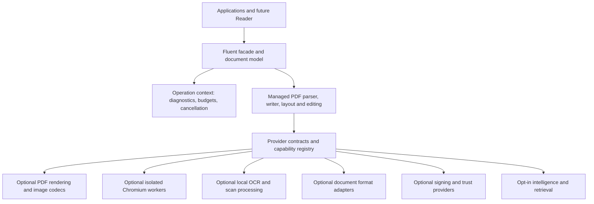

# Architecture

## Boundaries

The diagram is a target architecture. FP-001 implements the in-memory page model, immutable options and provider-backed I/O contracts described in [api-contract.md](api-contract.md). FP-003 adds [low-level syntax inspection](pdf-syntax.md); FP-005 adds the original managed [page reader and transactional writer](pdf-writing.md). FP-007 adds [typed content and version negotiation](content-operators.md). FP-008 adds an optional original [managed font provider](fonts.md); the core retains provider-neutral contracts and authored Type 3 resources. FP-009 adds original managed Unicode analysis and an optional isolated text shaper; [text contracts](text-shaping.md) retain logical Unicode and exact glyph geometry. FP-010 adds [managed vector/resource composition](vector-graphics.md), preserving color profiles, mesh/gradient data and vector transparency groups/masks. FP-011 through FP-015 add shared-context canvas, flow, tables, composition and bounded final page templates with deferred navigation. Rendering and later engines remain in progress.

## Managed core

The core owns PDF syntax/object identity, stream semantics, editing transactions, layout, strictness, diagnostics and public contracts. Native/provider types never appear in its public API. Cross-platform code does not depend on desktop sessions, GDI+ or installed office applications.

Use a typed object model with stable source/page/object provenance and explicit dirty state. Preserve safe unknown keys and opaque streams; changing a document must not silently discard unrecognized extensions. Low-level operators and high-level layout share resource ownership and version negotiation.

A document is an explicitly disposable editing session. Options are immutable snapshots. FP-001 validates individual geometry/collection edits before applying them and supplies detached snapshots to writers. General edit transactions and revision/signature behavior belong to later requirements. Incremental signing paths will preserve byte ranges; full rewrite paths will record signature/revision effects.

## Operation context

Each operation receives cancellation, deadlines, input/expanded/output budgets, object/depth/pixel limits, culture, deterministic font/model/engine selection, strictness, network policy and a diagnostic sink. A provider cannot weaken this context. Managed checks precede allocation; native/browser work is supervised for time, memory and process failures.

Diagnostic records use stable codes, severity, operation, page/object/region provenance, remediation and a loss category. Permissive output carries a complete loss report; strict output fails when requested behavior cannot be honored.

FP-002 implements immutable policy/limits, synchronized operation contexts, page/object diagnostic provenance, bounded input/output/decoder leases, overflow-safe counters and pixel dimensions, scoped depth/workers, cooperative deadlines and detached reports. Read/write providers must accept this context. Fatal policy failures are latched until the operation ends. See [operation-policies.md](operation-policies.md). Region-level provenance, network/resource-loading policy and supervised native workers are owned by the later feature requirements; no such engine is bundled or qualified here. FP-085 adds [offline deployment checks and isolated workers](native-deployment.md), implemented outside the core in the optional non-packable worker adapter and original native host. It checks pinned assets, probes ABI/version/dependencies and supervises platform-sandboxed execution. Native source validation passed; production qualification remains incomplete.

## Optional provider packages

Planned names are subject to prefix availability checks:

| Candidate package | Responsibility |
| --- | --- |
| Fluent.Pdf | Managed core, public contracts, fluent task APIs |
| Fluent.Pdf.Rendering | PDF raster/rendering and viewing primitives |
| Fluent.Pdf.Html | Chromium HTML/URL workers and print layout |
| Fluent.Pdf.Ocr | Local OCR, models/provisioning contracts, searchable PDF |
| Fluent.Pdf.Fonts | Optional redistributable font assets and deterministic resolution |
| Fluent.Pdf.Documents | Optional wordnet/document conversion adapter |
| Fluent.Pdf.Signing | External/HSM signing integrations |
| Fluent.Pdf.Intelligence | Explicit model/retrieval integrations |
| Fluent.Pdf.Native.* | Qualified RID-specific assets or provisioning manifests |

Packages share a release version when shipped together. Do not add empty provider packages. Provider selection must record engine/model version, SHA-256, ABI, platform applicability and capability set. Packaged native dependencies require licensing and servicing review. Runtime auto-download is off by default.

## Engine selection

Chromium is the intended optional web-layout engine. PDFium, PDF rendering through PdfPig/Skia, Tesseract and other engines are candidates, not settled dependencies merely because they appear in research. Qualify candidates on all required platforms for fidelity, memory, cancellation, distribution and security before adopting them. A renderer is not a general PDF editing core.

Legacy interpreter formats and untrusted native decoding use worker isolation. Define authenticated local/remote worker transport, crash recovery and per-job ownership. A container or remote worker is an explicit deployment mode; the SDK must not silently contact a hosted service.

## wordnet integration

The OCR patterns and exact upstream revision are assessed in [ocr-reuse.md](ocr-reuse.md). Extract/adapt only the reusable layer with attribution; its current English model and Windows/Linux release evidence do not establish multilingual/macOS support here.

A separate document adapter may depend on wordnet. The core must not depend on wordnet.Ocr, and wordnet must not gain a dependency back to this adapter. Prefer shared provider-neutral abstractions or an independently factored component if reuse would form a cycle.

## Security and standards

Do not execute PDF JavaScript, launch actions, external resources or embedded media by opening a document. Script evaluation and browser rendering are explicit operations with separate permissions. Redaction uses content removal and full rewrite, including revision/attachment policy; a visual rectangle is insufficient.

Conformance is established by independent validators and semantic review where required. PDF/A, accessibility, signatures and invoice compliance each have dedicated evidence. An emitted metadata flag is not proof.

## Reader boundary

apps/PdfReader is a separate non-packable project. It will consume public SDK contracts for rendering, navigation, search and interaction after a later specification. No GUI framework, visual clone, Reader runtime or desktop distribution is selected in this baseline.

The page canvas emits private vector Form XObjects under the managed core. Geometry captures all five standard boxes, viewing rotation and UserUnit. Completed canvases are immutable; synchronous builders own one operation context and thread. Application stages page resource/layer changes before committing. Source overlays retain the original encoded content streams behind an isolated graphics state.

Flow layout preserves paragraph bidi resolution and reshapes each wrapped line before painting rich text. Constraint planning and immutable page canvas construction share one bounded context. The planner stages complete results; save remains a separate managed document boundary.

Tables share the flow context for grid measurement, nested content, safe intervals and canvas output. Fragment painting copies individual placements with their captured clips, preserving one body text instance per fragment and intentional repeated headers. Nested continuation headers reserve ordered common bands.

Composition paints logical block order, including physical right-to-left columns. Basic column tagging wraps page-level content segments with MCIDs and builds ordered standard Div elements plus a parent number tree. This is separate from complete accessibility/conformance and explicit source-structure remapping. Footnotes reserve body space before committing their references; immutable definitions remain job-local in the planner.

Image assets retain immutable encoded byte stores and display metadata. Inspection captures source-owned resource scopes; occurrence editing clones the selected Form path in a transaction. Image decoding stays behind explicit provider interfaces; the managed core performs no color conversion or PDF rendering.

Annotation operations preserve source graphs through staged transactions and remap exact indirect identities on import. Normal appearances remain independent Forms with private resources. The owned XFDF graph extension retains encoded bytes and relationships within explicit XML/work/ownership ceilings. No imported action or media is evaluated.

Navigation binds local destinations to native page identities and validates reachable targets before document writes. Action inventory walks active object definitions and physical attachment edges without executing content; explicit sanitization stages a full graph overlay.

Presentation edits share the navigation graph boundary and retain indirect page identities. Outline link/count construction, number-tree inspection and preference validation remain managed and passive; unknown settings stay observable with diagnostics.

Metadata edits use the shared managed graph transaction. XML is preflighted and charged before bounded tree construction, with external resolution and DTDs disabled. Synchronization uses caller-selected authority and dates; removal rewrites the graph and requires an embedded-file decision. No system clock or random identity is introduced.

Embedded-file operations keep payload bytes behind bounded stream/filter leases. Extraction validates into private storage before output; same-directory file commits default to no overwrite. Inventory is passive, while collection and associated-file authoring use explicit PDF structures. Removal rewrites the full graph and drops prior revisions.

Optional-content decisions are operation-local and passive. Configuration evaluation binds exact OCG identities and explicit usage events. Flattening stages private resource/content rewrites, preserves graphics-state side effects and rejects unresolved state/semantic dependencies before commit.

Text extraction interprets page/Form text state in the shared context, caching source mappings/metrics per operation. It preserves source code order and declared ActualText independently of bounded geometric grouping. Coordinate records retain native user space and the existing displayed CropBox/rotation/UserUnit transform.

AcroForm capture resolves inherited field attributes under the graph operation context and keeps logical fields separate from exact terminal/widget identities. Edits preserve source object and structure links; authored private appearances and explicit default editing fonts have separate ownership. Scripts/XFA are never run during capture or editing.

Field-data parsing remains independent from document mutation. Filling/appearance generation shares the graph context; copy operations map exact ownership/resources and flattening removes both field-tree and page-widget relationships before validating surviving references. Incremental graph output preserves original bytes without asserting signature validity.

FP-031 keeps password/file-security algorithms in managed core and CMS behind `IPdfCmsEnvelopeProvider`. Optional `Fluent.Pdf.Cryptography` composes pinned ASN.1 and platform RSA/AES, without certificate-store discovery or private-key export. Explicit plaintext/security rewrites retain shared budgets and signature safeguards; see [security](security.md).

Archival generation/conversion uses the managed graph/writer and an explicit independent validator boundary. Core preflight is not a conformance oracle. Optional Fluent.Pdf.Compliance checks exact reports from a caller-supplied offline host; no browser/native/Java runtime is linked into core. Staged archival downgrades cannot reach caller output without complete matching independent validation.

Structural recovery has a separate scanner, explicit identity/stream authority, immutable original bytes and ledger. It does not catch ordinary parse errors or guess markers inside stream payloads. Reconstructed output passes the normal strict reader before final copying; this is structural validation rather than PDF standards or content-fidelity qualification.
